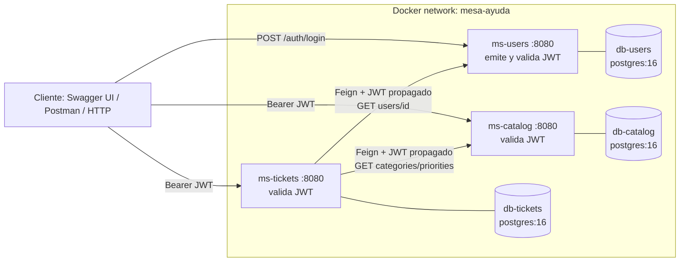
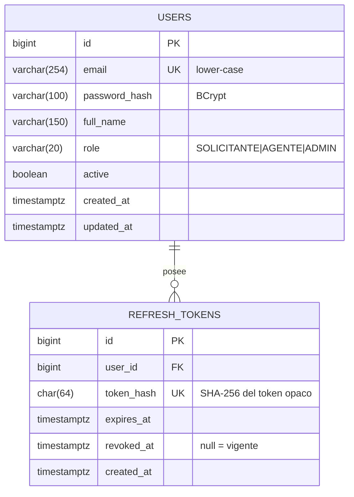
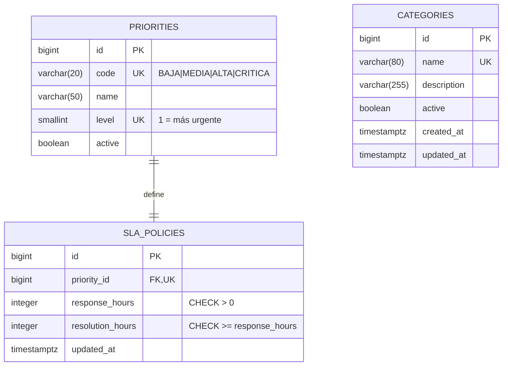
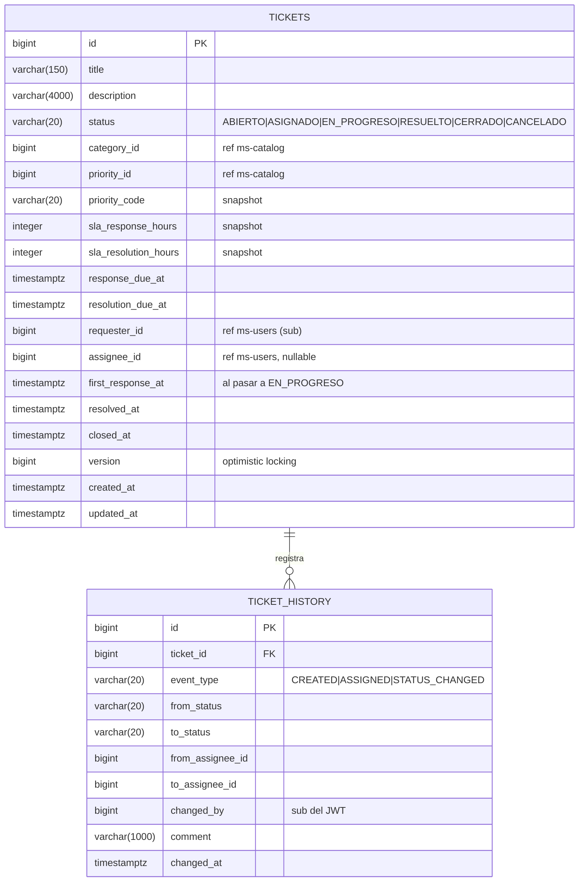
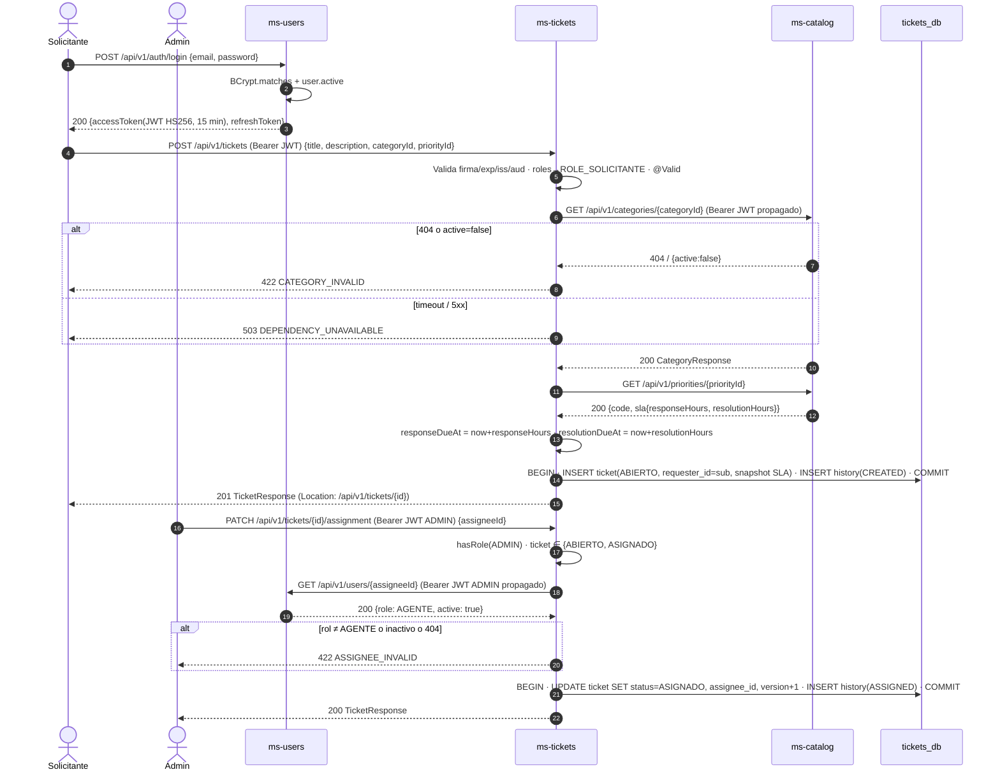
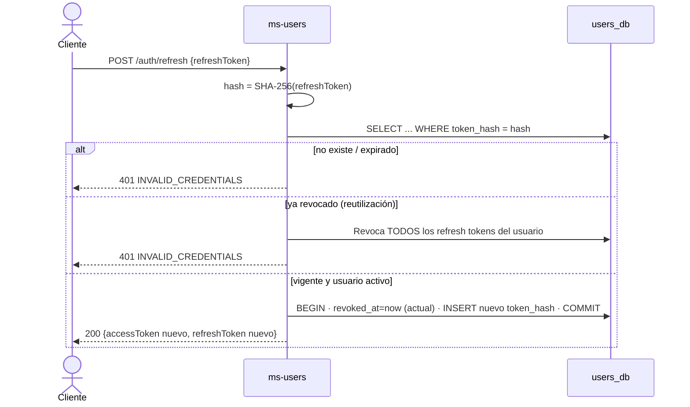

# Arquitectura — Mesa de Ayuda (beca-ia-equipo-1)

> Sistema de tickets de soporte con 3 microservicios Spring Boot MVC en un monorepo.
> Dueños: **Fernando → ms-users**, **Isaac → ms-tickets**, **Sebastián → ms-catalog**.

## 0. Decisiones confirmadas (ADR resumido)

| # | Decisión | Elección | Trade-off aceptado |
|---|---|---|---|
| D1 | Estilo | Microservicios, cada uno **MVC por capas** (controller → service → repository) | Menos aislamiento del dominio que hexagonal; a cambio, alineado con la guía y simple |
| D2 | Runtime | **Java 17**, Spring Boot **4.1.2** (pom actual) | Docker usa `eclipse-temurin:17`; la guía muestra 21 |
| D3 | Persistencia | **Base de datos por servicio**, **3 contenedores** `postgres:16` | Más RAM; aislamiento total y configuración sin scripts |
| D4 | Comunicación | **Solo REST síncrono** (OpenFeign) | Acoplamiento temporal: si un servicio cae, sus dependientes responden 503 |
| D5 | Identidad | JWT **HS256** con llave compartida (`JWT_SECRET`), **access + refresh token** | Toda la llave está en los 3 servicios; aceptable en la beca, no en producción |
| D6 | Ciclo del ticket | ABIERTO → ASIGNADO → EN_PROGRESO → RESUELTO → CERRADO; CANCELADO desde ABIERTO/ASIGNADO | — |
| D7 | Permisos | SOLICITANTE crea/ve los suyos; AGENTE ve asignados y cambia estado; ADMIN asigna, catálogo y usuarios | — |
| D8 | Registro | Público → SOLICITANTE; ADMIN crea AGENTE/ADMIN; ADMIN inicial por env al arrancar | — |
| D9 | Integridad entre servicios | ms-tickets valida asignado contra ms-users y catálogo contra ms-catalog | Dos dependencias síncronas |
| D10 | SLA | ms-tickets **copia el SLA** y calcula fechas límite al crear | Datos duplicados, pero históricos estables y sin llamadas para "vencidos" |
| D11 | Extras | Solo lo que pide la guía: Actuator (`health`), ProblemDetail, Flyway, quality gates, Docker, CI. **Sin** rate limiting, Resilience4j, correlation-id, Testcontainers ni paginación | Menos robustez operativa; alcance acotado a la beca |
| D12 | Código compartido | **Sin librería común**; cada servicio replica su config de JWT (~3 clases) | Duplicación pequeña a cambio de despliegue independiente |

## 1. Patrón de arquitectura y topología

### 1.1 Bounded contexts

| Contexto | Servicio | Dueño de los datos | Consume |
|---|---|---|---|
| Identidad y acceso | ms-users | usuarios, roles, refresh tokens | — |
| Catálogo de servicio | ms-catalog | categorías, prioridades, políticas SLA | (solo valida JWT) |
| Gestión de tickets | ms-tickets | tickets, historial | ms-catalog, ms-users |

Regla: **ningún servicio lee la base de otro**; las referencias externas son IDs (`category_id`, `requester_id`…) sin FK física.

### 1.2 Diagrama de alto nivel



### 1.3 Despliegue y desacoplamiento

| Servicio | Puerto interno | Puerto host | Base | Puerto host DB (solo dev) |
|---|---|---|---|---|
| ms-users | 8080 | 8081 | db-users / `users_db` | 5433 |
| ms-tickets | 8080 | 8082 | db-tickets / `tickets_db` | 5434 |
| ms-catalog | 8080 | 8083 | db-catalog / `catalog_db` | 5435 |

- Cada servicio es una imagen independiente (Dockerfile multi-stage, JRE 17, usuario no root).
- `docker-compose.yml` en la raíz: 3 DB con `healthcheck pg_isready`; cada servicio `depends_on: condition: service_healthy` solo de su DB. ms-tickets **no** depende del arranque de los otros servicios (falla en runtime con 503, no al arrancar).
- Healthcheck del servicio: `/actuator/health` (único endpoint de Actuator expuesto).
- Toda la configuración externa por variables de entorno → `.env` (no versionado) + `.env.example`.
- URLs entre servicios por configuración: `SERVICES_USERS_URL=http://ms-users:8080`, `SERVICES_CATALOG_URL=http://ms-catalog:8080`; en local (IDE) `http://localhost:8081/8083`.
- Perfiles: por defecto apunta a localhost (dev en IDE con `docker compose up db-*`); en compose todo llega por env.

## 2. Modelo de datos y persistencia

Convenciones: tablas y columnas en inglés `snake_case` plural; PK `BIGSERIAL`; fechas `TIMESTAMPTZ` (Java `Instant`); enums como `VARCHAR` + `CHECK`; `spring.jpa.hibernate.ddl-auto=validate`; `open-in-view=false`.

### 2.1 ms-users (`users_db`)



- Un rol por usuario (el claim es arreglo para extensibilidad).
- Índices: `UK(email)` (login); `idx_refresh_tokens_user_id` (revocar todos en logout/desactivar); `UK(token_hash)` (lookup en refresh).
- FK `refresh_tokens.user_id → users.id ON DELETE CASCADE`. Usuarios nunca se borran: `active=false`.
- **El refresh token nunca se guarda en claro**, solo su hash.

### 2.2 ms-catalog (`catalog_db`)



- 1:1 prioridad–SLA vía `UK(priority_id)`; FK `ON DELETE RESTRICT`.
- Borrado lógico (`active=false`) en categorías y prioridades: los tickets históricos siguen referenciándolas.
- Datos semilla (V2): 4 prioridades con SLA (CRITICA 1h/4h, ALTA 4h/24h, MEDIA 8h/48h, BAJA 24h/120h) y 3 categorías de ejemplo. *Valores ajustables por el equipo.*

### 2.3 ms-tickets (`tickets_db`)



- Índices: `idx_tickets_requester_created (requester_id, created_at DESC)` → "mis tickets"; `idx_tickets_assignee_status (assignee_id, status)` → bandeja del agente; `idx_tickets_status_resolution_due (status, resolution_due_at)` → vencidos por SLA; `idx_ticket_history_ticket_changed (ticket_id, changed_at)` → historial.
- `ticket_history` es **append-only** (sin UPDATE/DELETE en el repositorio). FK `ON DELETE RESTRICT`; los tickets no se borran (se cancelan).
- `@Version` evita que dos agentes/admins pisen un cambio de estado concurrente → 409.
- El cambio de estado y su fila de historial se guardan en **la misma transacción** (`@Transactional` en el service).

### 2.4 Estrategia de migraciones (Flyway)

- Ruta `src/main/resources/db/migration`, nombres `V{n}__{verbo}_{objeto}.sql` (p. ej. `V1__create_users_tables.sql`, `V2__seed_priorities_and_sla.sql`).
- Migraciones **inmutables** una vez en `main`; cualquier cambio es una nueva `V{n+1}`.
- Cada índice lleva comentario `-- justifica: HU-xx …` (rúbrica P1).
- Solo SQL portable de PostgreSQL 16; sin datos sensibles en migraciones (el ADMIN inicial lo crea un `ApplicationRunner` con `ADMIN_EMAIL`/`ADMIN_PASSWORD` si no existe ningún ADMIN).
- Boot 4 es modular: usar `spring-boot-starter-flyway` + `flyway-database-postgresql` (verificar en start.spring.io).

## 3. Contratos de API

Prefijo `/api/v1`. JSON. Fechas ISO-8601 UTC. IDs `Long`. Contratos OpenAPI publicados en `docs/contratos/ms-*.yaml` (generados con SpringDoc y versionados). Listados **sin paginación** (D11), con filtros simples.

### 3.1 ms-users

| Método | Ruta | Rol | Éxito | Errores |
|---|---|---|---|---|
| POST | `/auth/register` | público | 201 `UserResponse` | 400, 409 email |
| POST | `/auth/login` | público | 200 `TokenResponse` | 400, 401 |
| POST | `/auth/refresh` | público | 200 `TokenResponse` (rota) | 400, 401 |
| POST | `/auth/logout` | autenticado | 204 | 401 |
| GET | `/users/me` | autenticado | 200 `UserResponse` | 401 |
| GET | `/users?role=AGENTE` | ADMIN | 200 `UserResponse[]` | 401, 403 |
| GET | `/users/{id}` | ADMIN | 200 `UserResponse` | 401, 403, 404 |
| POST | `/users` | ADMIN | 201 `UserResponse` | 400, 401, 403, 409 |
| PATCH | `/users/{id}/status` | ADMIN | 200 `UserResponse` | 400, 401, 403, 404 |

```jsonc
RegisterRequest   { "email": string(email, ≤254), "password": string(8..72, letra+dígito), "fullName": string(2..150) }
CreateUserRequest { ...RegisterRequest, "role": "SOLICITANTE"|"AGENTE"|"ADMIN" }
LoginRequest      { "email": string, "password": string }
RefreshRequest    { "refreshToken": string }          // también body de /logout
UpdateStatusReq   { "active": boolean }
UserResponse      { "id": long, "email": string, "fullName": string, "role": string, "active": boolean, "createdAt": instant }
TokenResponse     { "accessToken": string, "tokenType": "Bearer", "expiresIn": 900,
                    "refreshToken": string, "refreshExpiresIn": 604800 }
```

Login y refresh fallidos responden **siempre** 401 "Credenciales inválidas" (no revela si el email existe o si el usuario está inactivo).

### 3.2 ms-catalog

| Método | Ruta | Rol | Éxito | Errores |
|---|---|---|---|---|
| GET | `/categories?active=true` | autenticado | 200 `CategoryResponse[]` | 401 |
| GET | `/categories/{id}` | autenticado | 200 | 401, 404 |
| POST | `/categories` | ADMIN | 201 | 400, 401, 403, 409 nombre |
| PUT | `/categories/{id}` | ADMIN | 200 | 400, 401, 403, 404, 409 |
| DELETE | `/categories/{id}` | ADMIN | 204 (lógico) | 401, 403, 404 |
| GET | `/priorities` | autenticado | 200 `PriorityResponse[]` | 401 |
| GET | `/priorities/{id}` | autenticado | 200 | 401, 404 |
| POST | `/priorities` | ADMIN | 201 | 400, 401, 403, 409 |
| PUT | `/priorities/{id}/sla` | ADMIN | 200 | 400, 401, 403, 404 |

```jsonc
CategoryRequest  { "name": string(2..80), "description": string(≤255)? }
CategoryResponse { "id": long, "name": string, "description": string, "active": boolean }
PriorityRequest  { "code": string(^[A-Z_]{3,20}$), "name": string(≤50), "level": int(1..10),
                   "sla": SlaRequest }
SlaRequest       { "responseHours": int(1..720), "resolutionHours": int(≥responseHours, ≤2160) }
PriorityResponse { "id": long, "code": string, "name": string, "level": int, "active": boolean,
                   "sla": { "responseHours": int, "resolutionHours": int } }
```

### 3.3 ms-tickets

| Método | Ruta | Rol | Éxito | Errores |
|---|---|---|---|---|
| POST | `/tickets` | SOLICITANTE | 201 `TicketResponse` | 400, 401, 403, 422 cat/prio inválida, 503 |
| GET | `/tickets?status=` | todos (filtrado por rol) | 200 `TicketResponse[]` | 401 |
| GET | `/tickets/{id}` | dueño / asignado / ADMIN | 200 | 401, 403, 404 |
| PATCH | `/tickets/{id}/assignment` | ADMIN | 200 | 400, 401, 403, 404, 409 estado, 422 no es AGENTE, 503 |
| PATCH | `/tickets/{id}/status` | según matriz §6.3 | 200 | 400, 401, 403, 404, 409 transición |
| GET | `/tickets/{id}/history` | dueño / asignado / ADMIN | 200 `HistoryResponse[]` | 401, 403, 404 |

```jsonc
CreateTicketRequest { "title": string(5..150), "description": string(10..4000),
                      "categoryId": long, "priorityId": long }
AssignRequest       { "assigneeId": long }
ChangeStatusRequest { "status": "EN_PROGRESO"|"RESUELTO"|"CERRADO"|"CANCELADO",
                      "comment": string(≤1000)? }   // ASIGNADO solo vía /assignment
TicketResponse      { "id", "title", "description", "status", "categoryId", "priorityId", "priorityCode",
                      "requesterId", "assigneeId"?, "responseDueAt", "resolutionDueAt",
                      "overdue": boolean,        // calculado: now > resolutionDueAt y no RESUELTO/CERRADO/CANCELADO
                      "createdAt", "updatedAt", "resolvedAt"?, "closedAt"? }
HistoryResponse     { "eventType", "fromStatus"?, "toStatus"?, "fromAssigneeId"?, "toAssigneeId"?,
                      "changedBy", "comment"?, "changedAt" }
```

### 3.4 Errores estandarizados (RFC 9457 `ProblemDetail`, sucesor de RFC 7807)

`Content-Type: application/problem+json`. Un `@RestControllerAdvice` por servicio, más `AuthenticationEntryPoint`/`AccessDeniedHandler` que devuelven el mismo formato para 401/403.

```jsonc
{
  "type": "https://mesa-ayuda.ids/problems/invalid-transition",
  "title": "Transición de estado no permitida",
  "status": 409,
  "detail": "No se puede pasar de ABIERTO a RESUELTO",
  "instance": "/api/v1/tickets/42/status",
  "code": "TICKET_INVALID_TRANSITION",
  "timestamp": "2026-11-04T15:00:00Z",
  "errors": [ { "field": "title", "message": "no debe estar vacío" } ]   // solo en 400
}
```

| HTTP | `code` | Cuándo |
|---|---|---|
| 400 | `VALIDATION_ERROR` / `MALFORMED_REQUEST` | Bean Validation / JSON ilegible / tipo de parámetro inválido |
| 401 | `UNAUTHORIZED` / `INVALID_CREDENTIALS` | Sin token, token inválido/expirado, login/refresh fallido |
| 403 | `FORBIDDEN` | Rol insuficiente o recurso ajeno |
| 404 | `*_NOT_FOUND` | Recurso inexistente |
| 409 | `*_ALREADY_EXISTS` / `TICKET_INVALID_TRANSITION` / `CONCURRENT_MODIFICATION` | Unicidad, máquina de estados, `@Version` |
| 422 | `CATEGORY_INVALID` / `PRIORITY_INVALID` / `ASSIGNEE_INVALID` | Referencia externa inexistente, inactiva o con rol incorrecto |
| 503 | `DEPENDENCY_UNAVAILABLE` | Timeout / 5xx / conexión rechazada de ms-users o ms-catalog |
| 500 | `INTERNAL_ERROR` | Genérico, **sin stack trace ni mensaje interno** (se loguea con detalle) |

Mapeo Feign (ms-tickets, `ErrorDecoder`): 404 del proveedor → 422 de negocio; 401/403 del proveedor → 503 (es un fallo de integración, no del usuario) con log WARN; 5xx/`RetryableException` → 503.

## 4. Diagramas de secuencia

### 4.1 Caso crítico: crear y asignar un ticket



### 4.2 Refresh token con rotación



## 5. Estructura del proyecto

### 5.1 Monorepo (estructura acordada por el equipo)

```
beca-ia-equipo-1/
├── ms-users/      (Fernando)   ├── ms-tickets/ (Isaac)   ├── ms-catalog/ (Sebastián)
│   ├── src/ · pom.xml · README.md · BITACORA-IA.md · Dockerfile · .dockerignore
│   ├── docs/ requerimientos.md · QUALITY-REPORT.md · SECURITY-REPORT.md
│   ├── prompts/ · .github/skills/ · config/checkstyle/ · config/pmd/
├── docs/  backlog.md · prompt-review.md · contratos/ms-*.yaml · herramientas.md · seguridad.md · plan-contenedores.md
├── .github/ pull_request_template.md · skills/{quality-gates-java,docker-springboot}/ · agents/devops.agent.md · workflows/ci.yml
├── AGENTS.md · docker-compose.yml · .env.example · .gitignore · README-EQUIPO.md
```

### 5.2 Interior de cada servicio (MVC por capas) — ejemplo ms-tickets

```
src/main/java/com/ids/ms_tickets/
├── MsTicketsApplication.java
├── config/          SecurityConfig, JwtDecoderConfig, OpenApiConfig, FeignConfig,
│                    properties/ (JwtProperties, ClientsProperties  — records @ConfigurationProperties)
├── security/        JwtRolesConverter, CurrentUser (sub + roles desde el Jwt),
│                    ProblemAuthenticationEntryPoint, ProblemAccessDeniedHandler
├── controller/      TicketController
├── service/         TicketService, TicketStateMachine, SlaCalculator
├── repository/      TicketRepository, TicketHistoryRepository
├── model/           Ticket, TicketHistory (entidades JPA), enums TicketStatus, HistoryEventType
├── dto/request/     CreateTicketRequest, AssignRequest, ChangeStatusRequest   (records)
├── dto/response/    TicketResponse, HistoryResponse                           (records)
├── mapper/          TicketMapper (manual, estático)
├── client/          CatalogClient, UsersClient (@FeignClient), client/dto/, FeignErrorDecoder,
│                    BearerTokenRelayInterceptor
└── exception/       NotFoundException, BusinessRuleException, InvalidTransitionException,
                     DependencyUnavailableException, GlobalExceptionHandler
src/main/resources/  application.yaml · db/migration/V1__create_ticket_tables.sql
src/test/java/...    espejo: controller/ (@WebMvcTest), service/ (Mockito), client/ (WireMock),
                     security/ (401/403/200)
```

ms-users añade `service/TokenService` (emite JWT con `NimbusJwtEncoder`), `service/RefreshTokenService`, `config/PasswordEncoderConfig`, `bootstrap/AdminBootstrap`. ms-catalog no tiene `client/`.

### 5.3 Convenciones

- Código, tablas y endpoints en **inglés**; mensajes al usuario y `detail` de errores en **español**; valores de dominio (roles, estados, códigos de prioridad) en **español** según el glosario del equipo.
- Paquete base: el generado (`com.ids.ms_users`, `com.ids.ms_tickets`, `com.ids.ms_catalog`).
- Clases: `*Controller`, `*Service`, `*Repository`, `*Request`/`*Response` (records), `*Exception`, `*Client`, `*Properties`.
- Lombok **solo** en entidades (`@Getter @Setter @NoArgsConstructor`, nunca `@Data` en JPA) y `@RequiredArgsConstructor` para inyección por constructor; DTOs son records.
- Entidades nunca salen del service; el controller solo recibe y devuelve DTOs.
- Sin valores en duro: TTLs, URLs, timeouts, límites, orígenes CORS y el costo de BCrypt van en `application.yaml` con `${ENV:default}`.
- Reglas de calidad de la guía: métodos ≤ 30 líneas, complejidad ciclomática ≤ 10, cobertura ≥ 70 %.

## 6. Seguridad

### 6.1 Identidad: JWT HS256

| Claim | Ejemplo | Uso |
|---|---|---|
| `iss` | `ms-users` | Validado por los 3 servicios |
| `aud` | `mesa-ayuda` | Validado por los 3 servicios |
| `sub` | `"42"` | ID del usuario → `requester_id`, `changed_by`, chequeo de propiedad |
| `email` | `ana@ids.mx` | Solo informativo (nunca se loguea) |
| `name` | `Ana Pérez` | Informativo |
| `roles` | `["AGENTE"]` | → `ROLE_AGENTE` vía `JwtAuthenticationConverter` personalizado |
| `iat` / `exp` | | Access token: **15 min** (`app.security.jwt.access-ttl`) |
| `jti` | UUID | Trazabilidad |

- Firma: `JWT_SECRET` ≥ 32 bytes (256 bits). Al arrancar se valida la longitud y el servicio falla si es más corta. Solo se lee de una variable de entorno, nunca de `application.yaml` en claro.
- Emisión solo en ms-users (`NimbusJwtEncoder` + `MacAlgorithm.HS256`). Validación en los 3 con `spring-boot-starter-oauth2-resource-server` (`NimbusJwtDecoder.withSecretKey`) + validadores de `iss` y `aud`.
- **Refresh token**: opaco (32 bytes aleatorios con `SecureRandom`, Base64URL), TTL de **7 días**, guardado como SHA-256. Se rota en cada uso; si se detecta reutilización se revocan todos los tokens del usuario. `logout` revoca el token, y desactivar un usuario revoca todos los suyos (el access token sigue vigente un máximo de 15 min, trade-off aceptado).
- Contraseñas: BCrypt (costo configurable, por defecto 10); longitud de 8 a 72 caracteres, porque BCrypt trunca a partir de 72 bytes.
- **Propagación servicio a servicio**: `BearerTokenRelayInterceptor` (Feign `RequestInterceptor`) copia el `Authorization` del `SecurityContext`. No hay credenciales de servicio, así que la llamada se autoriza con los permisos del usuario original.

### 6.2 SecurityFilterChain (común)

- Stateless, CSRF deshabilitado (API sin cookies), `oauth2ResourceServer().jwt()`, `@EnableMethodSecurity`.
- Públicos: `/actuator/health`, `/v3/api-docs/**`, `/swagger-ui/**` (este último activable con `SWAGGER_ENABLED`, por defecto `true`), y en ms-users además `/api/v1/auth/register`, `/auth/login` y `/auth/refresh`.
- Actuator: `management.endpoints.web.exposure.include=health` y `show-details=never`.
- `server.error.include-stacktrace=never`, `include-message=never`.
- **CORS**: deshabilitado por defecto, porque el consumo es servidor a servidor o desde Swagger en el mismo origen. Si se necesita, se configura un `CorsConfigurationSource` con `app.cors.allowed-origins=${CORS_ALLOWED_ORIGINS:}` y nunca `*`.
- **Rate limiting**: fuera de alcance (D11). Queda como riesgo documentado en SECURITY-REPORT para `/auth/login`.
- **Sanitización**: Bean Validation (`@NotBlank`, `@Size`, `@Email`, `@Pattern`, `@Positive`) en todos los DTOs; tamaño máximo en cada campo de texto; `email` normalizado a minúsculas; solo Spring Data o `@Query` con `:param`; la API solo devuelve JSON (sin HTML), así que el XSS se mitiga del lado del consumidor; los DTOs evitan mass assignment.
- **Logs**: nunca se registran contraseñas, tokens, `Authorization` ni emails.

### 6.3 Matriz de autorización (RBAC + chequeo de propiedad tipo ABAC en el service)

| Endpoint | SOLICITANTE | AGENTE | ADMIN |
|---|---|---|---|
| users: `/users/me`, `/auth/logout` | ✔ | ✔ | ✔ |
| users: `GET /users`, `/users/{id}`, `POST /users`, `PATCH status` | 403 | 403 | ✔ |
| catalog: GET | ✔ | ✔ | ✔ |
| catalog: POST/PUT/DELETE | 403 | 403 | ✔ |
| tickets: `POST /tickets` | ✔ | 403 | 403 |
| tickets: `GET /tickets` | propios | asignados | todos |
| tickets: `GET /{id}`, `/history` | si es dueño | si es el asignado | ✔ |
| tickets: `PATCH /assignment` | 403 | 403 | ✔ (ABIERTO o ASIGNADO) |
| status → EN_PROGRESO (desde ASIGNADO) | 403 | si es el asignado | ✔ |
| status → RESUELTO (desde EN_PROGRESO) | 403 | si es el asignado | ✔ |
| status → CERRADO (desde RESUELTO) | si es dueño | 403 | ✔ |
| status → CANCELADO (desde ABIERTO/ASIGNADO) | si es dueño | 403 | ✔ |

Un recurso ajeno responde **403**, como pide la guía en sus pruebas. La regla de rol se aplica en el `SecurityFilterChain` o con `@PreAuthorize`, y la de propiedad en el service con `CurrentUser`.

### 6.4 Manejo de secretos

`.env` (en `.gitignore`) contiene `JWT_SECRET`, `USERS_DB_USER/PASSWORD`, `TICKETS_DB_USER/PASSWORD`, `CATALOG_DB_USER/PASSWORD`, `ADMIN_EMAIL` y `ADMIN_PASSWORD`. Se versiona `.env.example` con valores de ejemplo. En CI, `NVD_API_KEY` se guarda como secret de GitHub. Los 3 servicios comparten `JWT_SECRET`; cada base tiene credenciales distintas.

## 7. Integración (ms-tickets)

- Spring Cloud OpenFeign: `@EnableFeignClients`, `url = "${clients.catalog.url}"` y `"${clients.users.url}"`.
- Timeouts en la configuración (`connect-timeout` 2 s, `read-timeout` 3 s), sin reintentos (D11).
- Los DTOs del cliente están en `client/dto` y son propios de ms-tickets, para no acoplarse a las clases del proveedor. El contrato se valida contra `docs/contratos/*.yaml` (prueba de contrato de P3).
- ⚠ **Riesgo de compatibilidad**: Spring Boot 4.1.2 necesita un release train de Spring Cloud que lo soporte. La tarea 0 lo verifica en start.spring.io. Si no hay ninguno compatible, la alternativa es usar **Spring HTTP Interface (`@HttpExchange`) + RestClient**, nativo de Spring Framework 7: la estructura de `client/` es la misma y no se necesita Spring Cloud. Esta decisión queda pendiente para Isaac.

## 8. Backlog técnico priorizado

Responsables: **F** = Fernando (ms-users), **I** = Isaac (ms-tickets), **S** = Sebastián (ms-catalog), **EQ** = equipo (con el rol rotativo indicado). Entre paréntesis va la práctica o el día de la guía.

### Fase 1: Core y datos (P1, días 1–2)
1. **EQ** Verificar la compatibilidad de las dependencias con Boot 4.1.2 (Spring Cloud/OpenFeign, `spring-boot-starter-flyway`, `oauth2-resource-server`, SpringDoc 3.x, Lombok). Fijar Java 17 y anotar el resultado en `AGENTS.md`.
2. **EQ** Limpiar el repo: revisar si existe el módulo residual `ms-users/users/`, completar `.gitignore` (target/, .env, .idea/) y crear `README-EQUIPO.md` y `.github/pull_request_template.md`.
3. **EQ** `docs/backlog.md`: épicas, HU por servicio y glosario (ticket, SLA, prioridad, asignación, estados, roles).
4. **F / I / S** `docs/requerimientos.md` de cada servicio: ≥ 5 HU, Gherkin con escenario negativo, 3 RNF y preguntas abiertas.
5. **S** Reactivar JPA y PostgreSQL en el pom de ms-catalog, agregar Flyway, `V1__create_catalog_tables.sql` y `V2__seed_priorities_and_sla.sql`.
6. **F** Flyway `V1__create_users_tables.sql` (users y refresh_tokens), entidad `User` y `UserRepository`.
7. **I** Flyway `V1__create_ticket_tables.sql`, entidades `Ticket` y `TicketHistory` con `@Version`, repositorios.
8. **EQ** `docker-compose.yml` mínimo con `db-users`, `db-tickets` y `db-catalog`, más `.env.example`, para desarrollar en local.

### Fase 2: Servicios y APIs (P1 días 2–3, P3 días 6–7)
9. **Todos** Base común en cada servicio: `GlobalExceptionHandler` con ProblemDetail, `@ConfigurationProperties` como records, `application.yaml` sin valores en duro, OpenAPI con SpringDoc.
10. **S** CRUD de categorías y prioridades con SLA (controller, service, repository, DTO, mapper).
11. **F** Registro, gestión de usuarios para ADMIN y `AdminBootstrap`.
12. **I** Crear y consultar tickets (sin integración todavía: el catálogo se simula detrás de una interfaz), `TicketStateMachine`, cambio de estado, historial y `SlaCalculator`.
13. **EQ** Publicar `docs/contratos/ms-*.yaml` y revisar con IA la compatibilidad entre lo que se consume y lo que se expone (P1-E).
14. **EQ** `docs/seguridad.md`: claims (§6.1), roles, TTL y propagación del token. Todos implementan igual (P3-E, día 7).
15. **F** Login con BCrypt, emisión de JWT con `NimbusJwtEncoder`, refresh con rotación y detección de reutilización, logout y `/users/me`.
16. **F / I / S** `SecurityConfig` de resource server: validación de iss/aud, `JwtRolesConverter`, entry point y access denied con ProblemDetail, Actuator solo con health, matriz §6.3.
17. **I** Chequeos de propiedad (dueño/asignado) y filtrado por rol en `GET /tickets`.

### Fase 3: Integraciones (P3, día 8)
18. **I** `CatalogClient` y `UsersClient` (Feign o HTTP Interface según la tarea 1), `BearerTokenRelayInterceptor`, `FeignErrorDecoder` (404→422, 5xx/timeout→503) y timeouts en la configuración.
19. **I** Integrar en la creación (categoría y prioridad con snapshot de SLA) y en la asignación (asignado activo y con rol AGENTE).
20. **F + S** Confirmar que `GET /users/{id}` y `GET /categories|priorities/{id}` cumplen el contrato que consume ms-tickets (prueba de contrato P3-E).

### Fase 4: Calidad, pruebas, contenedores y observabilidad (P1 día 3, P2 días 4–5, P3, P4 días 9–10)
21. **Todos** Pruebas: ≥ 8 por servicio en P1 (Mockito en el service, `@WebMvcTest` en el controller, positivos y negativos). Pruebas de la máquina de estados en ms-tickets y de rotación y reutilización en ms-users.
22. **Todos** Pruebas de seguridad: 401, 403 y éxito por endpoint (JWT de prueba o `jwt()` de spring-security-test), más una prueba del `JwtRolesConverter`.
23. **I** Prueba de los clientes con WireMock: respuestas 200, 404 → 422 y 500/timeout → 503.
24. **EQ** `AGENTS.md` común y skill `quality-gates-java` compartida (P2-E). Cada servicio llega a `mvn -B verify` en verde con cobertura ≥ 70 % y genera `QUALITY-REPORT.md`.
25. **Todos** Agente `revisor-seguridad` sobre su propio servicio y revisión cruzada en PR. Corregir los hallazgos CRÍTICOS y ALTOS y documentarlos en `SECURITY-REPORT.md`.
26. **Todos** Skill `docker-springboot`: Dockerfile multi-stage con `eclipse-temurin:17-jdk` y `17-jre`, usuario no root, `.dockerignore` e imagen etiquetada con la versión.
27. **EQ** Completar el `docker-compose.yml` con los 3 servicios, healthchecks, `depends_on` en su DB y variables de entorno desde `.env`. Verificar que `docker compose up -d` deja todo en UP.
28. **EQ** Agente `devops` y `.github/workflows/ci.yml` con una matriz `[ms-users, ms-tickets, ms-catalog]` que corre `./mvnw -B verify` y `docker build`, con el secret `NVD_API_KEY`. Guardar `docs/plan-contenedores.md`.
29. **EQ** `README-EQUIPO.md` con el flujo E2E (registro/login → crear ticket → asignar → EN_PROGRESO → RESUELTO → CERRADO → historial), una colección `.http` o de Postman y el diagrama para la demo.

Dependencias críticas: 1 → (5,6,7) → (10,11,12) → 15 → 16 → 18 → 19 → 23; 13 y 14 deben estar listas antes de la 18; la 26 necesita la 24; la 28 necesita la 27.

## 9. Riesgos y notas

- **Compatibilidad entre Boot 4.1.2 y Spring Cloud**: es el bloqueante principal de ms-tickets (alternativa en §7).
- Boot 4 usa Jackson 3 (`tools.jackson`) y starters modulares, y muchos ejemplos de la guía o de la IA están escritos para Boot 3. Hay que validar cada dependencia sugerida.
- La guía muestra Java 21 en el Dockerfile y en CI; el equipo usa 17, así que hay que ajustar las plantillas.
- La llave HS256 compartida implica que cualquier servicio podría emitir tokens. Se documenta como riesgo aceptado en SECURITY-REPORT.
- Sin resiliencia: si ms-catalog o ms-users caen, la creación o asignación de tickets responde 503 (comportamiento definido y probado).
