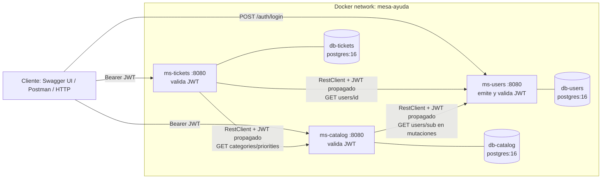

# README-EQUIPO: Mesa de Ayuda (ms-users, ms-catalog, ms-tickets)

Guía del equipo 1 para levantar los 3 microservicios con Docker Compose y probar el flujo completo. La fuente de verdad técnica es [ARCHITECTURE.md](./ARCHITECTURE.md).

## Propósito

Sistema de mesa de ayuda con solo 3 microservicios (Java 17, Spring Boot 4.1.2, PostgreSQL 16): identidad y acceso (`ms-users`), catálogo de categorías, prioridades y SLA (`ms-catalog`), y gestión de tickets (`ms-tickets`). Cada servicio tiene su propia base de datos.

## Arquitectura



## Servicios y puertos

| Servicio | Puerto interno | Puerto host | Base (servicio / nombre) | Puerto host DB |
|---|---|---|---|---|
| ms-users | 8080 | 8081 | db-users / `users_db` | 5433 |
| ms-tickets | 8080 | 8082 | db-tickets / `tickets_db` | 5434 |
| ms-catalog | 8080 | 8083 | db-catalog / `catalog_db` | 5435 |

## Requisitos

- Docker con Compose v2.
- Java 17 y el Maven wrapper (`./mvnw`) solo si ejecutas `verify` fuera de Docker.
- Postman (opcional) para la colección E2E.

## Configurar `.env`

1. Copia la plantilla: `Copy-Item .env.example .env`.
2. Reemplaza todos los `CAMBIA_...` y `TU_...` por valores propios. `JWT_SECRET` debe tener al menos 32 bytes.
3. `.env` nunca se versiona. `NVD_API_KEY` solo se necesita para `./mvnw verify`.

Si falta una variable obligatoria, `docker compose` falla con un mensaje que indica cuál.

## Levantar

```powershell
docker compose up -d --build
docker compose ps
```

Los 6 contenedores deben quedar `healthy` (los servicios tardan hasta 60 s en arrancar). Para detener sin borrar datos: `docker compose down`. `docker compose down -v` borra los volúmenes (`db-users-data`, `db-catalog-data`, `db-tickets-data`).

## Verificar health

```powershell
curl.exe http://localhost:8081/actuator/health
curl.exe http://localhost:8082/actuator/health
curl.exe http://localhost:8083/actuator/health
```

Cada uno debe responder `{"groups":["liveness","readiness"],"status":"UP"}`.

## Flujo E2E paso a paso

Flujo: registro/login → crear ticket → asignar (ADMIN) → EN_PROGRESO → RESUELTO → CERRADO → historial. Usa los endpoints de [ARCHITECTURE.md](./ARCHITECTURE.md) §3 y las credenciales de `ADMIN_EMAIL` y `ADMIN_PASSWORD` de tu `.env`. El ADMIN no cierra el ticket: lo cierra el SOLICITANTE dueño.

```powershell
$u = "http://localhost:8081/api/v1"; $k = "http://localhost:8083/api/v1"; $t = "http://localhost:8082/api/v1"
$admin = @{ email = "<ADMIN_EMAIL>"; password = "<ADMIN_PASSWORD>" }
$pass = "<CLAVE_CON_LETRA_Y_DIGITO>"
function Call($m, $url, $token, $body) {
  $h = @{}; if ($token) { $h.Authorization = "Bearer $token" }
  $p = @{ Method = $m; Uri = $url; Headers = $h; ContentType = "application/json" }
  if ($body) { $p.Body = ($body | ConvertTo-Json) }
  Invoke-RestMethod @p
}
$id = Get-Random

# 1. Registro de SOLICITANTE (público) y logins
Call POST "$u/auth/register" $null @{ email = "sol$id@example.com"; password = $pass; fullName = "Solicitante E2E" }
$adminTk = (Call POST "$u/auth/login" $null $admin).accessToken
$reqTk = (Call POST "$u/auth/login" $null @{ email = "sol$id@example.com"; password = $pass }).accessToken

# 2. ADMIN crea un AGENTE y este inicia sesión
$agent = Call POST "$u/users" $adminTk @{ email = "ag$id@example.com"; password = $pass; fullName = "Agente E2E"; role = "AGENTE" }
$agTk = (Call POST "$u/auth/login" $null @{ email = "ag$id@example.com"; password = $pass }).accessToken

# 3. Crear ticket (SOLICITANTE) con una categoría y prioridad del catálogo
$cat = (Call GET "$k/categories?active=true" $reqTk $null)[0].id
$pri = (Call GET "$k/priorities" $reqTk $null)[0].id
$ticket = Call POST "$t/tickets" $reqTk @{ title = "Impresora sin red"; description = "La impresora del piso 2 no responde"; categoryId = $cat; priorityId = $pri }

# 4. Asignar (ADMIN) -> ASIGNADO
Call PATCH "$t/tickets/$($ticket.id)/assignment" $adminTk @{ assigneeId = $agent.id }

# 5. EN_PROGRESO y RESUELTO (AGENTE asignado)
Call PATCH "$t/tickets/$($ticket.id)/status" $agTk @{ status = "EN_PROGRESO"; comment = "Revisando" }
Call PATCH "$t/tickets/$($ticket.id)/status" $agTk @{ status = "RESUELTO"; comment = "Reconfigurada" }

# 6. CERRADO (SOLICITANTE dueño) e historial (ADMIN)
Call PATCH "$t/tickets/$($ticket.id)/status" $reqTk @{ status = "CERRADO"; comment = "Confirmo" }
Call GET "$t/tickets/$($ticket.id)/history" $adminTk $null
```

Casos de rechazo que debes poder reproducir: crear ticket sin token → 401; asignar como SOLICITANTE → 403; cerrar como AGENTE → 403; cambiar el estado de un ticket cerrado → 409.

### Colección Postman

- Colección: [ms-mesa-ayuda-e2e.postman_collection.json](./docs/postman/ms-mesa-ayuda-e2e.postman_collection.json)
- Entorno: [ms-mesa-ayuda-local.postman_environment.json](./docs/postman/ms-mesa-ayuda-local.postman_environment.json)

Importa ambos, edita en el entorno `adminEmail` y `adminPassword` (placeholders) y ejecuta la colección completa en orden con el Collection Runner. Hace login, guarda los tokens y recorre el flujo con 17 peticiones: éxito y rechazos 401, 403 y 409. Dejar `agentEmail` y `requesterEmail` vacíos genera cuentas nuevas en cada corrida.

Cada servicio también tiene su colección propia en `ms-*/postman/`.

## CI

- `.github/workflows/ci.yml`: matriz `ms-users`, `ms-catalog`, `ms-tickets` con `./mvnw -B verify` y `docker build`. Corre en `push` a `equipo/**` y `main`, y en `pull_request`.
- `ci-<nombre>.yml` se conservan: cada uno cubre su servicio en ramas `practica-*` y en pull requests a `main`, por lo que en esos PR se solapan con `ci.yml`.
- Configura `NVD_API_KEY` como secret del repositorio (Settings → Secrets and variables → Actions).

## Seguridad

- JWT HS256 con `JWT_SECRET`, `JWT_ISSUER` y `JWT_AUDIENCE` compartidos: `ms-users` emite y los 3 validan.
- Los secretos viven solo en `.env` (no versionado); el código y los `.yaml` los leen como `${VAR}` sin valor por defecto.
- Los errores usan `ProblemDetail` sin detalles internos. Ver [docs/seguridad.md](./docs/seguridad.md).

## Solución de problemas

| Problema | Causa y solución |
|---|---|
| Puerto 8081-8083 o 5433-5435 ocupado | Detén el proceso que lo usa o cambia el puerto host en `docker-compose.yml`. |
| `required variable ... is missing a value` | Falta esa variable en `.env`; cópiala de `.env.example`. |
| `mvnw: Permission denied` (Linux/macOS/CI) | `chmod +x mvnw` en la carpeta del servicio. |
| Flyway falla al arrancar | Datos de una versión anterior en el volumen. Revisa los logs con `docker compose logs <servicio>`; si es un entorno de desarrollo, recrea el volumen (`docker compose down -v`, borra datos). |
| Un servicio no conecta con otro | Dentro de Docker se usan nombres de servicio (`http://ms-users:8080`); desde tu IDE, `localhost` con los puertos del host. |
| 503 al crear o asignar tickets | `ms-catalog` o `ms-users` no responde; revisa `docker compose ps`. |

## Resultados de Hadolint y Trivy

- **ms-tickets:** Hadolint sin hallazgos y Trivy con 0 vulnerabilidades HIGH o CRITICAL en `ms-tickets:0.0.1`, según `ms-tickets/BITACORA-IA.md` (filas 24 y 25, 13/11).
- **ms-users y ms-catalog:** pendiente, no se han ejecutado.
