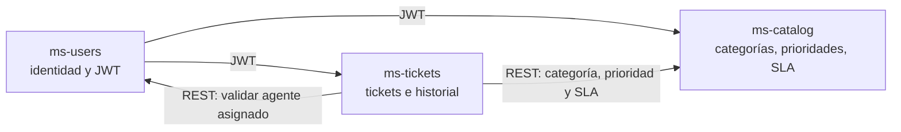

# Backlog del equipo — Mesa de Ayuda (Práctica 1)

> Repositorio: `beca-ia-equipo-1` · Práctica 1 (días 1–3) · Entrega: tag `p1-entrega`
>
> Este documento es el **índice común** del sistema. El detalle de cada HU (criterios Gherkin,
> RNF y preguntas abiertas) vive en el `docs/requerimientos.md` de cada microservicio y se enlaza
> desde aquí.

| Microservicio | Responsable | Requerimientos detallados |
|---|---|---|
| ms-users | Fernando | [ms-users/docs/requerimientos.md](../ms-users/docs/requerimientos.md) |
| ms-catalog | Sebastián | [ms-catalog/docs/requerimientos.md](../ms-catalog/docs/requerimientos.md) |
| ms-tickets | Isaac | [ms-tickets/docs/requerimientos.md](../ms-tickets/docs/requerimientos.md) |

Convenciones del backlog:

- **ID de HU:** `HU-<SVC>-NN` con `SVC` = `USR` (ms-users), `CAT` (ms-catalog), `TCK` (ms-tickets).
  Cada `requerimientos.md` debe usar exactamente estos IDs como encabezado para que los enlaces funcionen.
- **Prioridad:** MoSCoW (Must / Should / Could / Won't).
- **Estimación:** puntos de historia (Fibonacci: 1, 2, 3, 5, 8).
- Lo que no se deduce del texto de la guía está marcado como **SUPUESTO**.

---

## 1. Visión del sistema

Los colaboradores (**solicitantes**) reportan problemas mediante **tickets**. Un **administrador**
los asigna a un **agente**, que los atiende hasta resolverlos. Cada ticket tiene una **categoría** y
una **prioridad**; la prioridad define un **SLA** (horas para responder y para resolver). Todo cambio
de un ticket queda en su **historial**.



---

## 2. Épicas

| ID | Épica | Objetivo de negocio | Servicio(s) | HU |
|---|---|---|---|---|
| EP-01 | Identidad y acceso | Que cada persona entre al sistema con su rol y solo vea lo que le corresponde | ms-users | HU-USR-01 … 05 |
| EP-02 | Catálogo y SLA | Clasificar los tickets y fijar tiempos de atención por prioridad | ms-catalog | HU-CAT-01 … 07 |
| EP-03 | Ciclo de vida del ticket | Registrar, asignar, atender y cerrar solicitudes de soporte | ms-tickets | HU-TCK-01 … 06 |
| EP-04 | Trazabilidad y cumplimiento de SLA | Saber quién cambió qué y cuándo, y detectar tickets vencidos | ms-tickets | HU-TCK-07, 08 |
| EP-05 | Plataforma (técnica) | Calidad, seguridad, contenedores y CI comunes | Todos | Prácticas 2–4 (fuera de P1) |

---

## 3. Historias de usuario

### 3.1 ms-users — EP-01 Identidad y acceso (Fernando)

| ID | Historia | Prioridad | Pts | Enlace |
|---|---|---|---|---|
| <a id="hu-usr-01"></a>HU-USR-01 | Como **visitante** quiero registrarme con email y contraseña para poder crear tickets como solicitante. | Must | 3 | [detalle](../ms-users/docs/requerimientos.md#hu-usr-01) |
| <a id="hu-usr-02"></a>HU-USR-02 | Como **usuario registrado** quiero iniciar sesión para obtener un token y usar los servicios. | Must | 5 | [detalle](../ms-users/docs/requerimientos.md#hu-usr-02) |
| <a id="hu-usr-03"></a>HU-USR-03 | ~~Como **usuario autenticado** quiero que se bloquee temporalmente mi cuenta tras intentos fallidos para proteger mis credenciales.~~ **Retirada**: ARCHITECTURE no contempla el bloqueo temporal (423). | Must | 5 | [detalle](../ms-users/docs/requerimientos.md#hu-usr-03) |
| <a id="hu-usr-04"></a>HU-USR-04 | Como **usuario autenticado** quiero consultar mi perfil para verificar mis datos vigentes. | Should | 3 | [detalle](../ms-users/docs/requerimientos.md#hu-usr-04) |
| <a id="hu-usr-05"></a>HU-USR-05 | Como **administrador** quiero cambiar el estado de una cuenta para retirar su acceso sin perder su historial. | Should | 3 | [detalle](../ms-users/docs/requerimientos.md#hu-usr-05) |

Escenarios negativos mínimos que el detalle debe cubrir: email duplicado (409), credenciales
inválidas o usuario inactivo (401, mismo mensaje), rol distinto de ADMIN en HU-USR-05 (403).
El bloqueo temporal (423) de HU-USR-03 se retiró y ya no es un escenario negativo.

### 3.2 ms-catalog — EP-02 Catálogo y SLA (Sebastián)

| ID | Historia | Prioridad | Pts | Enlace |
|---|---|---|---|---|
| HU-CAT-01 | Como **usuario autenticado** quiero consultar las categorías activas para clasificar un ticket. | Must | 2 | [detalle](../ms-catalog/docs/requerimientos.md#hu-cat-01) |
| HU-CAT-02 | Como **administrador** quiero crear una categoría para reflejar un nuevo tipo de solicitud. | Must | 2 | [detalle](../ms-catalog/docs/requerimientos.md#hu-cat-02) |
| HU-CAT-03 | Como **administrador** quiero editar una categoría para corregir su nombre o descripción. | Should | 2 | [detalle](../ms-catalog/docs/requerimientos.md#hu-cat-03) |
| HU-CAT-04 | Como **administrador** quiero desactivar una categoría para que no se use en tickets nuevos sin afectar los existentes. | Should | 2 | [detalle](../ms-catalog/docs/requerimientos.md#hu-cat-04) |
| HU-CAT-05 | Como **usuario autenticado** quiero consultar las prioridades con su SLA para saber en cuánto tiempo me atenderán. | Must | 2 | [detalle](../ms-catalog/docs/requerimientos.md#hu-cat-05) |
| HU-CAT-06 | Como **administrador** quiero crear una prioridad con su SLA para ampliar los niveles de atención. | Must | 3 | [detalle](../ms-catalog/docs/requerimientos.md#hu-cat-06) |
| HU-CAT-07 | Como **administrador** quiero ajustar las horas de respuesta y resolución de una prioridad para alinear el SLA con el negocio. | Must | 3 | [detalle](../ms-catalog/docs/requerimientos.md#hu-cat-07) |

Escenarios negativos mínimos: nombre o código duplicado (409), recurso inexistente (404),
`resolutionHours < responseHours` u horas ≤ 0 (400), rol distinto de ADMIN en altas y cambios (403).

### 3.3 ms-tickets — EP-03 y EP-04 (Isaac)

| ID | Historia | Épica | Prioridad | Pts | Enlace |
|---|---|---|---|---|---|
| HU-TCK-01 | Como **solicitante** quiero crear un ticket con título, descripción, categoría y prioridad para reportar un problema. | EP-03 | Must | 5 | [detalle](../ms-tickets/docs/requerimientos.md#hu-tck-01) |
| HU-TCK-02 | Como **usuario autenticado** quiero listar los tickets que me corresponden (los míos, los asignados a mí o todos si soy admin) y filtrarlos por estado. | EP-03 | Must | 3 | [detalle](../ms-tickets/docs/requerimientos.md#hu-tck-02) |
| HU-TCK-03 | Como **usuario autenticado** quiero ver el detalle de un ticket al que tengo acceso para conocer su situación. | EP-03 | Must | 2 | [detalle](../ms-tickets/docs/requerimientos.md#hu-tck-03) |
| HU-TCK-04 | Como **administrador** quiero asignar o reasignar un ticket a un agente para que alguien se haga responsable. | EP-03 | Must | 5 | [detalle](../ms-tickets/docs/requerimientos.md#hu-tck-04) |
| HU-TCK-05 | Como **agente** quiero cambiar el estado de un ticket asignado a EN_PROGRESO y luego a RESUELTO para reflejar mi avance. | EP-03 | Must | 5 | [detalle](../ms-tickets/docs/requerimientos.md#hu-tck-05) |
| HU-TCK-06 | Como **solicitante** quiero cerrar mi ticket resuelto o cancelarlo si ya no lo necesito para terminar la solicitud. | EP-03 | Must | 3 | [detalle](../ms-tickets/docs/requerimientos.md#hu-tck-06) |
| HU-TCK-07 | Como **usuario con acceso al ticket** quiero ver su historial de cambios para saber quién hizo qué y cuándo. | EP-04 | Must | 3 | [detalle](../ms-tickets/docs/requerimientos.md#hu-tck-07) |
| HU-TCK-08 | Como **administrador** quiero saber si un ticket está vencido por SLA para priorizar la atención. | EP-04 | Should | 3 | [detalle](../ms-tickets/docs/requerimientos.md#hu-tck-08) |

Escenarios negativos mínimos: categoría o prioridad inexistente o inactiva (422), ticket ajeno (403),
transición de estado no permitida (409), asignar a un usuario que no es AGENTE o está inactivo (422),
rol incorrecto para crear o asignar (403).

### 3.4 Resumen

| Servicio | HU | Must | Should | Puntos |
|---|---|---|---|---|
| ms-users | 5 | 3 | 2 | 19 |
| ms-catalog | 7 | 5 | 2 | 16 |
| ms-tickets | 8 | 7 | 1 | 29 |
| **Total** | **20** | **15** | **5** | **64** |

---

## 4. Reglas de negocio comunes

| ID | Regla | Origen |
|---|---|---|
| RN-01 | Existen tres roles: SOLICITANTE, AGENTE y ADMIN. Cada usuario tiene uno. | Guía §2.3 / SUPUESTO (uno por usuario) |
| RN-02 | El registro público siempre crea SOLICITANTE; solo un ADMIN crea AGENTE o ADMIN. | Decisión del equipo |
| RN-03 | Estados del ticket: ABIERTO → ASIGNADO → EN_PROGRESO → RESUELTO → CERRADO; CANCELADO solo desde ABIERTO o ASIGNADO. | Decisión del equipo |
| RN-04 | Solo el ADMIN asigna tickets y solo a usuarios activos con rol AGENTE. | Decisión del equipo |
| RN-05 | Solo el agente asignado (o un ADMIN) mueve el ticket a EN_PROGRESO y RESUELTO. | Decisión del equipo |
| RN-06 | Solo el solicitante dueño (o un ADMIN) cierra o cancela su ticket. | Decisión del equipo |
| RN-07 | Cada prioridad tiene un SLA: horas de respuesta y horas de resolución (resolución ≥ respuesta). | Guía §2.3 |
| RN-08 | Al crear un ticket se copia el SLA vigente y se calculan sus fechas límite; cambios posteriores al catálogo no afectan tickets existentes. | Decisión del equipo |
| RN-09 | Un ticket está **vencido** si pasó su fecha límite de resolución y no está RESUELTO, CERRADO ni CANCELADO. | SUPUESTO |
| RN-10 | Todo cambio de asignación o estado se registra en el historial y no puede modificarse ni borrarse. | Guía §2.3 (historial) |
| RN-11 | Usuarios, categorías y prioridades no se borran físicamente: se desactivan. | SUPUESTO |

---

## 5. Requerimientos no funcionales transversales

| ID | Tipo | Requerimiento |
|---|---|---|
| RNF-01 | Seguridad | Todo endpoint, salvo registro, login, renovación, `/actuator/health` y la documentación OpenAPI, exige un JWT válido. |
| RNF-02 | Seguridad | Las contraseñas se guardan con BCrypt; ningún secreto (llave JWT, credenciales de BD) vive en el código. |
| RNF-03 | Seguridad | Las respuestas de error usan ProblemDetail (RFC 9457) sin stack traces ni detalles internos. |
| RNF-04 | Datos | Cada servicio tiene su propia base PostgreSQL 16; ningún servicio accede a la base de otro. |
| RNF-05 | Datos | El esquema se versiona con migraciones Flyway; cada índice se justifica con la HU que lo requiere. |
| RNF-06 | Integración | Si un servicio del que depende ms-tickets no responde, la operación devuelve 503 en un máximo de 5 s. |
| RNF-07 | Mantenibilidad | Arquitectura controller → service → repository; DTOs como records; configuración en `application.yaml`. |
| RNF-08 | Calidad | `mvn -B verify` en verde; mínimo 8 pruebas por servicio en P1 (cobertura ≥ 70 % desde P2). |
| RNF-09 | Auditoría | El historial registra quién (ID del usuario del JWT), qué y cuándo (UTC). |

Cada servicio debe detallar al menos 3 RNF propios en su `requerimientos.md`.

---

## 6. Dependencias entre servicios

| Consumidor | Proveedor | Para qué | Endpoint (contrato en `docs/contratos/`) | HU que lo requieren |
|---|---|---|---|---|
| ms-catalog | ms-users | Validar JWT (solo llave compartida, sin llamada HTTP) | — | Todas las de CAT |
| ms-tickets | ms-users | Validar JWT | — | Todas las de TCK |
| ms-tickets | ms-catalog | Validar categoría activa | `GET /api/v1/categories/{id}` | HU-TCK-01 |
| ms-tickets | ms-catalog | Obtener prioridad y su SLA | `GET /api/v1/priorities/{id}` | HU-TCK-01, HU-TCK-08 |
| ms-tickets | ms-users | Validar que el asignado es AGENTE activo | `GET /api/v1/users/{id}` | HU-TCK-04 |

Orden de implementación sugerido: ms-users (JWT) y ms-catalog en paralelo → ms-tickets.

---

## 7. Glosario del dominio

Término único que todo el equipo usa en documentos, HU y mensajes; nombre equivalente en el código.

| Término | Definición | En código / API | Evitar (sinónimos inconsistentes) |
|---|---|---|---|
| Ticket | Solicitud de soporte registrada por un solicitante. | `Ticket`, `/tickets` | incidencia, caso, reporte, petición |
| Solicitante | Usuario que crea tickets. Rol `SOLICITANTE`. | `requester`, `requesterId` | cliente, usuario final, reportante |
| Agente | Usuario de soporte que atiende tickets asignados. Rol `AGENTE`. | `assignee`, `assigneeId` | técnico, soporte, operador |
| Administrador | Usuario que asigna tickets y administra usuarios y catálogo. Rol `ADMIN`. | `ADMIN` | supervisor, superusuario |
| Categoría | Tipo de problema (p. ej. Hardware, Software, Accesos). | `Category`, `/categories` | tipo, área, clasificación |
| Prioridad | Nivel de urgencia de un ticket; determina su SLA. Códigos: CRITICA, ALTA, MEDIA, BAJA. | `Priority`, `/priorities` | urgencia, severidad, impacto |
| SLA | Acuerdo de nivel de servicio: horas máximas para responder y para resolver según la prioridad. | `SlaPolicy`, `sla` | tiempo de servicio, ANS |
| Tiempo de respuesta | Horas máximas para que un agente empiece a atender (pase a EN_PROGRESO). | `responseHours` | tiempo de atención |
| Tiempo de resolución | Horas máximas para que el ticket llegue a RESUELTO. | `resolutionHours` | tiempo de cierre |
| Fecha límite | Fecha calculada al crear el ticket: creación + horas del SLA. | `responseDueAt`, `resolutionDueAt` | vencimiento, deadline |
| Vencido | Ticket que superó su fecha límite de resolución sin resolverse (RN-09). | `overdue` | atrasado, expirado |
| Asignación | Acción del ADMIN de designar al agente responsable de un ticket. | `assignment`, `/assignment` | delegación, turno |
| Estado | Etapa del ciclo de vida (RN-03). | `TicketStatus` | situación, fase |
| Resuelto | El agente dio solución; falta la confirmación del solicitante. | `RESUELTO` | terminado, solucionado |
| Cerrado | El solicitante (o ADMIN) confirmó la solución; estado final. | `CERRADO` | finalizado. **No** usar como sinónimo de "resuelto" |
| Cancelado | El ticket se anuló antes de atenderse; estado final. | `CANCELADO` | eliminado, rechazado |
| Historial | Registro inmutable de cambios de asignación y estado. | `TicketHistory`, `/history` | bitácora (reservado para `BITACORA-IA.md`), log |
| Copia de SLA | SLA guardado en el ticket al crearlo (RN-08). | `slaResponseHours`, `slaResolutionHours` | — |
| Token de acceso | JWT de corta duración que identifica al usuario y su rol. | `accessToken` | — |
| Token de renovación | Token de larga duración para obtener un nuevo token de acceso. | `refreshToken` | — |
| Desactivar | Marcar un registro como inactivo sin borrarlo (RN-11). | `active = false` | eliminar, borrar |

### 7.1 Revisión de consistencia de términos (con IA)

Cada dueño ejecuta este prompt cuando su `requerimientos.md` esté listo y el **Documentador**
registra el resultado aquí y en `BITACORA-IA.md`:

```text
## ROL
Actúa como analista de requerimientos que revisa la consistencia de un dominio.
## CONTEXTO
Glosario del equipo: #file:docs/backlog.md (sección 7).
Requerimientos: #file:ms-users/docs/requerimientos.md #file:ms-catalog/docs/requerimientos.md
#file:ms-tickets/docs/requerimientos.md
## TAREA
Detecta términos que no coinciden con el glosario, sinónimos de la columna "Evitar",
estados o roles escritos distinto y reglas que se contradigan entre servicios.
## RESTRICCIONES
No reescribas los archivos; solo reporta.
## FORMATO DE SALIDA
Tabla: Archivo | Línea o HU | Término encontrado | Término del glosario | Corrección sugerida.
## VERIFICACIÓN
Si no encuentras inconsistencias en un archivo, dilo explícitamente.
```

| Fecha | Archivo | Término encontrado | Corrección | Estado |
|---|---|---|---|---|
| _pendiente_ | | | | |

---

## 8. Supuestos y preguntas abiertas

### Supuestos

- **SUPUESTO-01:** un usuario tiene un único rol.
- **SUPUESTO-02:** los valores iniciales de SLA son CRITICA 1 h/4 h, ALTA 4 h/24 h, MEDIA 8 h/48 h y BAJA 24 h/120 h, contados en horas naturales (no hábiles).
- **SUPUESTO-03:** un ticket vencido sigue su flujo normal; el vencimiento solo se informa (no bloquea ni escala).
- **SUPUESTO-04:** el ADMIN inicial se crea al arrancar ms-users con credenciales de variables de entorno.
- **SUPUESTO-05:** no hay notificaciones ni reportes (equipo de 3: se omiten ms-notificaciones y ms-reportes).

### Preguntas abiertas (para el instructor o "cliente")

1. ¿El SLA se mide en horas naturales o en horario laboral?
2. ¿Un ticket RESUELTO puede reabrirse si el solicitante no está conforme?
3. ¿El AGENTE puede ver tickets no asignados o autoasignarse?
4. ¿Se puede cambiar la categoría o prioridad de un ticket ya creado? Si cambia la prioridad, ¿se recalcula el SLA?
5. ¿Los tickets RESUELTOS se cierran solos después de cierto tiempo?
6. ¿Hay que adjuntar archivos o agregar comentarios a un ticket fuera de los cambios de estado?

---

## 9. Plan de trabajo de la Práctica 1

| # | Tarea | Responsable | Día | Entregable |
|---|---|---|---|---|
| 1 | Asignar microservicios y roles rotativos de P1 | Equipo | 1 | Tabla de roles (abajo) |
| 2 | Texto de negocio (5–8 líneas) y `requerimientos.md` con ≥ 5 HU, Gherkin con negativos, 3 RNF y preguntas | Fernando / Isaac / Sebastián | 1–2 | `ms-*/docs/requerimientos.md` |
| 3 | Modelo de datos y migración Flyway V1 (índices justificados) | Cada dueño | 2 | `ms-*/src/main/resources/db/migration/` |
| 4 | CRUD por capas con DTOs (records), validaciones, ProblemDetail y `application.yaml` | Cada dueño | 2–3 | Código del servicio |
| 5 | ≥ 8 pruebas (Mockito + `@WebMvcTest`) | Cada dueño | 3 | `mvn -B verify` en verde |
| 6 | ≥ 4 prompts con las 7 piezas y `BITACORA-IA.md` | Cada dueño | 1–3 | `ms-*/prompts/`, `ms-*/BITACORA-IA.md` |
| 7 | Este backlog y la revisión de consistencia de términos (§7.1) | Equipo | 3 | `docs/backlog.md` |
| 8 | Borradores OpenAPI de cada servicio y revisión de compatibilidad consumidor ↔ proveedor | Cada dueño + Integrador | 3 | `docs/contratos/ms-*.yaml` |
| 9 | Prompt review cruzado (30 min) con la tabla de 7 piezas | Equipo | 3 | `docs/prompt-review.md` |
| 10 | PR `practica-1 → main` con plantilla, tag `p1-entrega` | Cada dueño + Líder técnico | 3 | PR y tag |

Rotación sugerida para el prompt review: Fernando revisa a Isaac, Isaac revisa a Sebastián y Sebastián revisa a Fernando.


### Definición de terminado (HU)

- [ ] Criterios Gherkin con al menos un escenario negativo en `requerimientos.md`.
- [ ] Endpoint implementado por capas, con validaciones y errores en ProblemDetail.
- [ ] Pruebas que cubren el escenario positivo y el negativo, en verde.
- [ ] Endpoint documentado en `docs/contratos/<servicio>.yaml`.
- [ ] Interacción con IA registrada en `BITACORA-IA.md`.