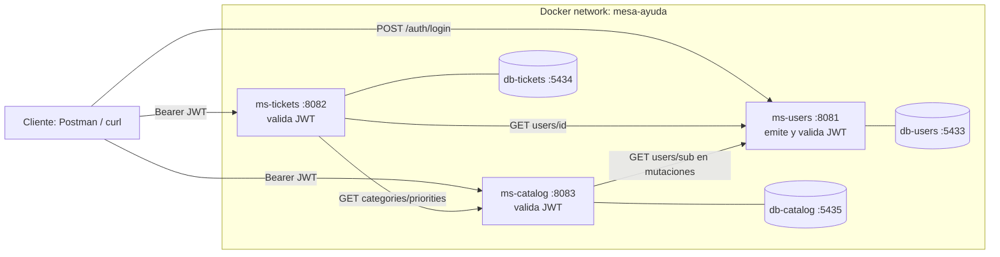

# Demo del equipo 1: Mesa de Ayuda (15 min)

Demo de los 3 microservicios (`ms-users`, `ms-catalog`, `ms-tickets`) en Docker Compose, con el flujo E2E en vivo y el uso de IA. Referencias: [README-EQUIPO.md](../README-EQUIPO.md) y [ARCHITECTURE.md](../ARCHITECTURE.md).

## Minutaje

| Min | Bloque | Contenido |
|---|---|---|
| 0:00–2:00 | Contexto | Problema, 3 servicios, una base por servicio, JWT compartido |
| 2:00–4:00 | Arquitectura | Diagrama y tabla de puertos |
| 4:00–6:00 | Arranque | `docker compose up -d`, `ps` healthy, `/actuator/health` |
| 6:00–11:00 | E2E en vivo | Flujo completo con rechazos 401, 403 y 409 |
| 11:00–13:00 | IA | Prompt + skills + agentes, con un ejemplo real |
| 13:00–14:30 | Herramientas y lecciones | Qué haría diferente cada herramienta; 3 lecciones |
| 14:30–15:00 | Cierre | CI y preguntas |

## 1. Arquitectura



Puertos host: ms-users 8081, ms-tickets 8082, ms-catalog 8083; bases 5433, 5434 y 5435.

## 2. Guion del flujo E2E en vivo

Preparación antes de la demo: `.env` completo (copiado de `.env.example`) y el stack ya construido (`docker compose up -d --build`) para no esperar el build.

```powershell
docker compose up -d
docker compose ps
curl.exe http://localhost:8081/actuator/health
curl.exe http://localhost:8082/actuator/health
curl.exe http://localhost:8083/actuator/health
```

Para el flujo, usa una de estas dos opciones:

- **Postman** (recomendado en vivo): importa [la colección](./postman/ms-mesa-ayuda-e2e.postman_collection.json) y [el entorno](./postman/ms-mesa-ayuda-local.postman_environment.json), rellena `adminEmail` y `adminPassword` y lanza el Collection Runner. Son 17 peticiones y 24 aserciones.
- **PowerShell**: ejecuta el bloque de "Flujo E2E paso a paso" de [README-EQUIPO.md](../README-EQUIPO.md).

Qué comentar en cada paso:

| Paso | Acción | Resultado esperado |
|---|---|---|
| 1 | Registrar SOLICITANTE (público) y login | 201 y tokens |
| 2 | ADMIN crea un AGENTE | 201, rol AGENTE |
| 3 | SOLICITANTE lee catálogo y crea ticket | 201, estado ABIERTO |
| 4 | Crear ticket sin token | 401 |
| 5 | Asignar como SOLICITANTE | 403 |
| 6 | Asignar como ADMIN | 200, ASIGNADO |
| 7 | AGENTE pasa a EN_PROGRESO y a RESUELTO | 200 |
| 8 | AGENTE intenta cerrar | 403 |
| 9 | SOLICITANTE dueño cierra | 200, CERRADO |
| 10 | Mover un ticket cerrado | 409 |
| 11 | ADMIN consulta el historial | 200, 4 o más eventos |

Plan B si falla algo: mostrar `docker compose logs ms-tickets` y el resultado del último `verify` con `BUILD SUCCESS`.

## 3. Cómo se usaron prompt, skills y agentes

- **Prompt maestro por fases:** la P4 se ejecutó con un prompt maestro con "Stop & Wait": una fase a la vez, resumen con la tabla `Archivo | Qué hace | Cómo se probó` y confirmación antes de seguir. Los commits los hace el equipo a mano, en lotes de 5 archivos o menos.
- **Skills:** `quality-gates-java` (Checkstyle, PMD, SpotBugs, Dependency-Check y JaCoCo) y `docker-springboot` (Dockerfile, `.dockerignore` y compose), en `.github/skills/`.
- **Agentes:** `devops` (compose, CI y verificación) y los revisores de solo lectura `revisor-seguridad-ms-users`, `-ms-catalog` y `-ms-tickets`, en `.github/agents/`.

### Ejemplo real: caché de NVD en CI (BITACORA-IA de ms-users, P3 #9, 13/11)

- **Problema:** Dependency-Check fallaba en CI con HTTP 503 de la API de NVD en la carga inicial (run 43475650763, 3 intentos).
- **Con qué:** skill `quality-gates-java`.
- **Qué hizo la IA:** un paso `update-only` con reintentos y guardado de la caché antes de `verify`.
- **Qué decidió el equipo:** usar los feeds oficiales JSON 2.0 de NIST (`nvdDatafeedUrl`) en lugar de la API, sin cambiar el POM ni desactivar gates.
- **Resultado:** push 43480208647 y PR 43480221322 en success, con 105 pruebas sin fallos. Riesgo anotado: los feeds se publican una vez al día.
- **Reutilización en P4:** `ci.yml` usa ese mismo mecanismo. Además, durante la P4 el mirror `dependency-check.github.io` devolvió 404 y el feed oficial funcionó.

## 4. Qué haría diferente cada herramienta de IA

SUPUESTO: las bitácoras no incluyen este punto de forma explícita; esta tabla resume lo que sí registran y el equipo debe confirmarla antes de la demo.

| Herramienta | Uso registrado | Qué haríamos diferente |
|---|---|---|
| Gemini | P1 de ms-users: requerimientos, modelo y pruebas | Verificar de entrada versiones y dependencias contra Boot 4.1.2 y Java 17; la bitácora anota ajustes manuales en el stack. |
| GitHub Copilot (Claude Haiku 5.5 y Sonnet 5.5) | Código, pruebas, skills, agentes y CI | Dar desde el inicio las reglas del repositorio (`copilot-instructions.md`) y pedir siempre la ejecución real de `./mvnw -B verify`. |
| Agentes revisores | Revisión de seguridad de solo lectura | Exigir evidencia (archivo y línea) en cada afirmación; ms-users #8 de P3 anota un comentario con afirmaciones sin comprobar. |

## 5. Tres lecciones aprendidas

1. **Verificar en ejecución, no en el texto.** Los feeds, versiones y puertos se comprobaron corriendo el sistema: el mirror de NVD caído, los 503 de la API y el `baseUrl` de Postman en 8080 en vez de 8083 solo aparecieron al ejecutar.
2. **Las plantillas de la guía no se copian sin adaptar.** La guía muestra Java 21 y 4 servicios con nombres en español; el equipo usa Java 17 y 3 servicios (`ARCHITECTURE.md` D2). Las decisiones escritas en una sola fuente de verdad evitaron la deriva.
3. **Trabajar por fases con confirmación.** Una fase a la vez, con commits pequeños y supuestos marcados como `SUPUESTO:`, hizo que cada cambio fuera revisable y que lo no ejecutado quedara como "pendiente" y no como aprobado.
