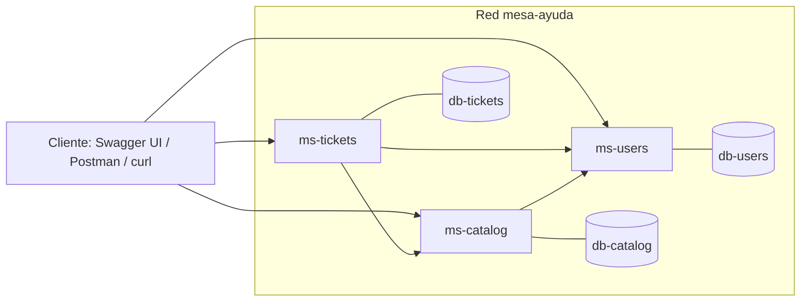

# Plan de contenedores: Mesa de Ayuda

Plan aprobado para ejecutar `ms-users`, `ms-catalog` y `ms-tickets` con Docker Compose. Es coherente con `ARCHITECTURE.md` (§0, §1.3, §6.4 y §7), que prevalece ante cualquier diferencia.

## 1. Topología

Tres servicios Spring Boot y tres bases `postgres:16` (una por servicio) en la red `mesa-ayuda`. Ningún servicio lee la base de otro.

Dependencias síncronas por REST: ms-tickets → ms-catalog y ms-users; ms-catalog → ms-users; ms-users no consume a nadie (D13).

## 2. Puertos

| Servicio | Puerto interno | Puerto host | Base (servicio / nombre) | Puerto host DB |
|---|---|---|---|---|
| ms-users | 8080 | 8081 | db-users / `users_db` | 5433 |
| ms-tickets | 8080 | 8082 | db-tickets / `tickets_db` | 5434 |
| ms-catalog | 8080 | 8083 | db-catalog / `catalog_db` | 5435 |

ms-users lee `PORT` (por defecto 8081); en compose se fija `PORT=8080` para coincidir con `EXPOSE` y el healthcheck. Los puertos de las bases en el host son solo para desarrollo.

## 3. Variables de entorno

Se definen en `.env` (no versionado); `.env.example` solo lleva placeholders. Compose usa `${VAR:?mensaje}` en las obligatorias, así que falla pronto si falta alguna.

| Variable | Usada por | Notas |
|---|---|---|
| `USERS_DB_USER`, `USERS_DB_PASSWORD` | db-users, ms-users | |
| `CATALOG_DB_USER`, `CATALOG_DB_PASSWORD` | db-catalog, ms-catalog | |
| `TICKETS_DB_USER`, `TICKETS_DB_PASSWORD` | db-tickets, ms-tickets | |
| `JWT_SECRET` | los 3 servicios | Secreto HS256 compartido, sin valor por defecto |
| `JWT_ISSUER`, `JWT_AUDIENCE` | los 3 servicios | `ms-users` y `mesa-ayuda` en el ejemplo |
| `ADMIN_EMAIL`, `ADMIN_PASSWORD` | ms-users | ADMIN inicial al arrancar |
| `NVD_API_KEY` | `./mvnw verify` y CI | No lo usa compose |

Compose fija además `SPRING_DATASOURCE_URL`, `SPRING_DATASOURCE_USERNAME` y `SPRING_DATASOURCE_PASSWORD` por servicio, `SERVICES_USERS_URL=http://ms-users:8080` y `SERVICES_CATALOG_URL=http://ms-catalog:8080`.

## 4. Healthchecks y orden de arranque

- Bases: `pg_isready` sobre su propia base.
- Servicios: `curl -fsS http://localhost:8080/actuator/health` (único endpoint de Actuator expuesto), con `start_period` de 40 s (ms-users y ms-catalog) y 60 s (ms-tickets).
- Cada servicio usa `depends_on: condition: service_healthy` solo de su base. ms-tickets no espera a los demás servicios: si caen, responde 503 en runtime (D4, §9).

## 5. Volúmenes

Un volumen nombrado por base, para conservar datos entre reinicios: `db-users-data`, `db-catalog-data` y `db-tickets-data`. Compose genera los nombres de contenedor (`<proyecto>-<servicio>-<n>`) y no se usa `container_name`. `docker compose down -v` borra los datos y requiere aprobación.

## 6. Decisiones

| # | Decisión | Aplicación |
|---|---|---|
| D2 | Java 17, Spring Boot 4.1.2 | Imágenes `eclipse-temurin:17` (JDK para build, JRE para ejecutar); no se usa Java 21 |
| D3 | Una base por servicio, 3 contenedores `postgres:16` | 3 servicios `db-*` con volumen propio y credenciales distintas |
| D4 | Solo REST síncrono | URLs internas por nombre de servicio; sin broker ni resiliencia adicional |

## 7. Verificación

1. `docker compose config -q` valida la sintaxis y las variables.
2. `docker compose up -d --build` y `docker compose ps`: los 6 contenedores deben quedar `healthy`.
3. `curl http://localhost:8081/actuator/health`, `8082` y `8083` deben devolver `{"status":"UP"}`.
4. `./mvnw -B verify` en cada servicio debe terminar en `BUILD SUCCESS`.
5. CI: `.github/workflows/ci.yml` ejecuta `verify` y `docker build` por servicio.

## 8. CI

`ci.yml` usa una matriz `[ms-users, ms-catalog, ms-tickets]` y corre en `push` a `equipo/**` y `main` y en `pull_request`. Los `ci-<nombre>.yml` se conservan, acotados a las ramas `practica-*`. `NVD_API_KEY` debe estar como secret del repositorio.

## 9. Riesgos

| Riesgo | Mitigación |
|---|---|
| Puertos 8081-8083 o 5433-5435 ocupados | Liberarlos o cambiar el puerto host en compose |
| `JWT_SECRET` compartido entre servicios | Riesgo aceptado (D5); se documenta en SECURITY-REPORT |
| Arranque lento de Flyway y JVM | `start_period` en healthchecks |
| Contenedores o redes antiguos del proyecto | Limpiar con `docker compose down --remove-orphans` antes de levantar |
| Fallo de red o NVD en el análisis | Se marca como pendiente, no como aprobado |
| Hadolint y Trivy | Pendientes, aún no ejecutados |
