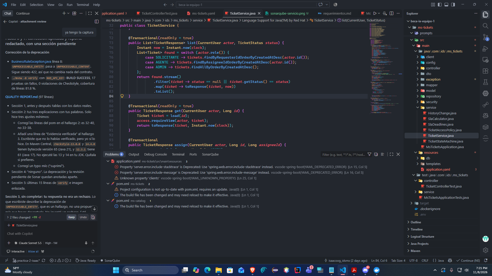

# QUALITY-REPORT: ms-tickets (Práctica 2)

Autor: Isaac Osoños · Rama `practica-2-isaac` · Stack: Java 17, Spring Boot 4.1.2, Maven.
Solo se reporta lo ejecutado. Lo que no se ejecutó figura como "pendiente" con el motivo.

## 1. Antes y después

Detalle completo del estado inicial en `prompts/p2-reporte-antes.md`.

| Herramienta | Versión | ANTES | DESPUÉS |
|---|---|---|---|
| Checkstyle | 12.3.1 (plugin 3.6.0) | 1 (`ConstantName`) | 0 |
| PMD | 7.29.0 (plugin 3.28.0) | 0 | 0 |
| SpotBugs + FindSecBugs | 4.10.5 / 1.14.0 | 0 | 0 |
| Dependency-Check | 13.0.0 | 3 CVE de DOMPurify (2 con CVSS 10.0) | 0 con CVSS >= 7 |
| JaCoCo (líneas, umbral 70 %) | 0.8.16 | 81.8 % (216/264) | 81.8 % (216/264) |

Resumen por regla (ANTES):

| Herramienta | Regla | Archivos | Cantidad |
|---|---|---|---|
| Checkstyle | ConstantName | `GlobalExceptionHandler.java:25` | 1 |
| Dependency-Check | CVE-2026-116804, CVE-2026-116803 (CVSS 10.0) y CVE-2026-116802 (sin puntuar) | `swagger-ui-bundle.js` y `swagger-ui-es-bundle.js` (swagger-ui 5.34.0) | 3 CVE |

Cobertura de ramas: 52.1 % (38/73), sin umbral. Pruebas: 17, 0 fallos, 0 omitidas.

Dependency-Check corrió con `NVD_API_KEY`. El analizador Sonatype OSS Index quedó deshabilitado por falta de credenciales: **pendiente** de revisar con esa fuente.

### 1.1 Configuración compartida (revisión del PR #24, punto 3)

Se reemplazaron `config/checkstyle/checkstyle.xml` y `config/pmd/ruleset.xml` por `references/checkstyle.xml` y `references/pmd-ruleset.xml`. Sin diferencias contra las referencias.

| Elemento | ANTES (config propia de P2) | DESPUÉS (config compartida) |
|---|---|---|
| Módulos de Checkstyle | Faltaban `NewlineAtEndOfFile`, `AvoidNestedBlocks`, `OneStatementPerLine`, `MultipleVariableDeclarations` e `InnerAssignment` | Los 5 presentes |
| Reglas de PMD | Faltaban 10 (p. ej. `MissingOverride`, `EqualsNull`, `DoubleCheckedLocking`) | Las 10 presentes |
| Checkstyle | No se volvió a ejecutar con la config anterior | 0 violaciones |
| PMD | No se volvió a ejecutar con la config anterior | 0 violaciones |
| CPD (`cpd-check`) | No se volvió a ejecutar con la config anterior | Ejecutado en `verify`, sin fallos |
| SpotBugs | 0 | 0 (`BugInstance size is 0`) |
| Pruebas | 17 | 17, 0 fallos |
| JaCoCo (líneas) | 81.8 % | "All coverage checks have been met" (umbral 70 %) |
| Dependency-Check | pendiente | 0 vulnerabilidades reportadas, `BUILD SUCCESS` con `NVD_API_KEY` cargada desde `.env` |

Código: sin cambios. La configuración compartida no produjo hallazgos nuevos. El `ConstantName` de la tabla anterior ya estaba corregido (`LOGGER` en `GlobalExceptionHandler.java:25`).

PMD muestra un aviso (no una violación) de que `AvoidLosingExceptionInformation` se retirará en PMD 8. Se deja la regla porque viene de la referencia compartida.

`./mvnw -B verify` termina con `BUILD SUCCESS` con `NVD_API_KEY` cargada desde `ms-tickets/.env`. Sin esa clave, Dependency-Check falla con `Invalid API Key` y el resultado queda como pendiente.

## 2. Tres hallazgos explicados

### 2.1 Checkstyle `ConstantName` en `GlobalExceptionHandler.java:25`

**Qué era.** Checkstyle reportó, con severidad error, una violación de `ConstantName`. El campo `private static final Logger log` es una constante porque es `static final`, y su nombre no cumple el patrón `^[A-Z][A-Z0-9]*(_[A-Z0-9]+)*$` que exige el módulo en `checkstyle.xml`.

**Por qué era un problema.** Rompía la convención de nombres de Java: las constantes van en UPPER_SNAKE_CASE. Con severidad error, el hallazgo hacía fallar el quality gate de Checkstyle y bloqueaba el build. Era un hallazgo de estilo, sin impacto en el comportamiento.

**Cómo lo corregí.** Renombré el campo a `LOGGER` en su declaración (línea 25) y actualicé su único uso, `LOGGER.error("Error no controlado en {}", request.getRequestURI(), ex)` (línea 57). No cambié ninguna regla ni usé supresiones: corregí el código, no la configuración.

### 2.2 Dependency-Check: DOMPurify 3.4.16 dentro de swagger-ui

**Qué era.** Dependency-Check, con el analizador RetireJS, detectó tres CVE de DOMPurify 3.4.16. Esa librería JavaScript viene empaquetada en `swagger-ui-bundle.js` y `swagger-ui-es-bundle.js`, dentro de `swagger-ui-5.34.0.jar`. No era código nuestro: la ruta era `springdoc-openapi-starter-webmvc-ui:3.2.0`, que arrastraba swagger-ui 5.34.0.

**Por qué importaba.** DOMPurify es el sanitizador de HTML/XSS de Swagger UI. Un bypass permite XSS en la página `/swagger-ui` a quien abra una spec maliciosa. Con CVSS 10.0 superaba el umbral `failBuildOnCVSS=7` del `pom.xml`, así que rompía `verify`. `SWAGGER_ENABLED` está en `true` por defecto, por lo que la UI está expuesta.

**Cómo lo corregí y por qué no lo suprimí.** Mi prompt de correcciones (`prompts/p2-corregir-hallazgos.md`) prohíbe silenciar o excluir reglas: "Un falso positivo se explica y se discute; no se silencia". Suprimir habría dejado la vulnerabilidad real en el artefacto desplegado y solo habría ocultado el aviso. No era un falso positivo, así que correspondía arreglar la causa. springdoc 3.2.0 es la última versión publicada, así que no había una versión de springdoc que subir. Fijé `org.webjars:swagger-ui:5.34.1` en `dependencyManagement` (líneas 32-40 del `pom.xml`). Eso cambia solo la versión transitiva y no añade una dependencia nueva. Antes de aplicarlo, mostré el diff y esperé aprobación.

Evidencia: la versión 5.34.0 del webjar contiene DOMPurify 3.4.16 y la 5.34.1 contiene 3.4.17 (se leyó en el JAR). Con 5.34.1, `dependency-check:check` terminó en BUILD SUCCESS.

### 2.3 Checkstyle 13.x y 14.x no corren en Java 17

**Qué era.** El proyecto usa Java 17 (`java.version=17` en el `pom.xml`). Al buscar la última versión de Checkstyle, las líneas 13.x y 14.x aparecen como más nuevas que la 12.3.1, pero están compiladas para Java 21.

**Por qué era un problema.** Un Checkstyle compilado para Java 21 no puede cargarse en una JVM 17 (`UnsupportedClassVersionError`). Es un fallo de entorno, no un hallazgo de código, y rompería `verify` en la fase donde corre `checkstyle:check`. Subir la versión por rutina "para estar al día" habría dejado sin análisis de estilo al proyecto. Subir Java a 21 solo por esto habría sido un cambio de alcance.

**Cómo lo resolví.** Dejé Checkstyle fijado en 12.3.1, la última línea compatible con Java 17, como dependencia del plugin `maven-checkstyle-plugin` 3.6.0 (líneas 199-206 del `pom.xml`). Dejé escrito en `SKILL.md` que hay que confirmar en Maven Central que Checkstyle siga corriendo en Java 17 antes de cambiar versiones. No cambié el pom en este punto: es una decisión de no actualizar, no una modificación.

Evidencia verificada: en `Main.class` de `checkstyle-13.0.0.jar` y `checkstyle-14.4.0.jar` la versión de bytecode es 65 (Java 21); en `checkstyle-12.3.0` y `12.3.1` es 61 (Java 17). No ejecuté las versiones 13 y 14 en el JDK 17.

## 3. Propuesta de la IA que rechacé

**Propuesta.** Al consultar Maven Central por la versión estable más reciente de Checkstyle, la IA obtuvo **14.4.0** como candidata natural para fijar en el plugin.

**Qué hice.** La rechacé: esa versión no corre en Java 17, solo en Java 21. Dejé Checkstyle en **12.3.1**, la última que corre en Java 17.

**Por qué.** El proyecto usa Java 17. Subir a 14.4.0 habría roto `checkstyle:check` en `verify`, o habría obligado a subir Java a 21 por una herramienta de estilo.

Evidencia verificada: `Main.class` de `checkstyle-14.4.0.jar` y `13.0.0` tiene versión de bytecode 65 (Java 21); la de `12.3.1` es 61 (Java 17). La versión 14.4.0 nunca se escribió en el `pom.xml`.

## 4. Falsos positivos

Ninguno. Todos los hallazgos de los analizadores eran reales.

Avisos que no vienen de los analizadores de Maven y que se tratan aparte:
- `BusinessRuleException.java:8`: `HttpStatus.UNPROCESSABLE_ENTITY` está deprecado desde Spring Framework 7.0 (RFC 9110 renombró el 422 a "Unprocessable Content"). Se cambió a `HttpStatus.UNPROCESSABLE_CONTENT`. El código HTTP sigue siendo 422 y los contratos de `docs/contratos/` no cambian.
- `application.yaml:15-16`: `server.error.include-stacktrace` y `server.error.include-message` están deprecadas en Spring Boot 4 (ahora `spring.web.error.*`). La extensión de Spring Boot del IDE las marca. **Decisión: no se tocaron**, quedan documentadas. Siguen en `never`, así que no se exponen stack traces.
- `application.yaml:25`: `clients` aparece como propiedad desconocida. Son metadatos del IDE, no afecta la ejecución.
- SonarQube for IDE: sin avisos en `TicketService.java`. La revisión de Security Hotspots y taint requiere modo conectado a SonarQube Server/Cloud: **pendiente**, el workspace no está enlazado.

## 5. Evidencia

Comando: `./mvnw -B verify` con `NVD_API_KEY` en el entorno, 2026-11-08, `BUILD SUCCESS`, 17 pruebas sin fallos, `You have 0 Checkstyle violations`, `All coverage checks have been met`.

Últimas 15 líneas de la salida:

```text
[INFO] Finished NVD CVE Analyzer (0 seconds)
[INFO] Finished RetireJS Analyzer (4 seconds)
[WARNING] Sonatype OSS Index Analyzer disabled due to missing credentials. Authentication with token is now required, and OSS Index is migrating to Sonatype Guide. See https://dependency-check.github.io/DependencyCheck/analyzers/oss-index-analyzer.html for more information on authentication with Sonatype Guide OSS Index.
[INFO] Finished Vulnerability Suppression Analyzer (0 seconds)
[INFO] Finished Known Exploited Vulnerability Analyzer (0 seconds)
[INFO] Finished Dependency Bundling Analyzer (0 seconds)
[INFO] Finished Unused Suppression Rule Analyzer (0 seconds)
[INFO] Analysis Complete (11 seconds)
[INFO] Writing HTML report to: ...\ms-tickets\target\dependency-check-report.html
[INFO] ------------------------------------------------------------------------
[INFO] BUILD SUCCESS
[INFO] ------------------------------------------------------------------------
[INFO] Total time:  01:01 min
[INFO] Finished at: 2026-11-08T19:13:26-06:00
[INFO] ------------------------------------------------------------------------
```

Captura de SonarQube for IDE sobre `TicketService.java`:


